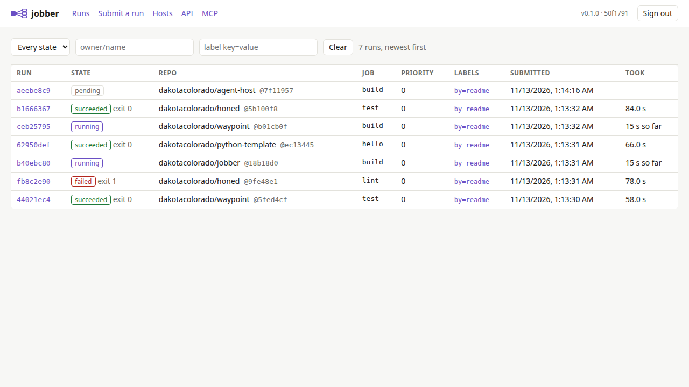

# jobber

**Submit code to run on whatever computers you have.**

```
     ██╗ ██████╗ ██████╗ ██████╗ ███████╗██████╗       ▄▄▄▄▄▄▄▄▄▄
     ██║██╔═══██╗██╔══██╗██╔══██╗██╔════╝██╔══██╗      █ █ ██ █ █
     ██║██║   ██║██████╔╝██████╔╝█████╗  ██████╔╝      ▀▀▀▀▀▀▀▀▀▀
██   ██║██║   ██║██╔══██╗██╔══██╗██╔══╝  ██╔══██╗  █▀█▀▀█▀█  █▀█▀▀█▀█
╚█████╔╝╚██████╔╝██████╔╝██████╔╝███████╗██║  ██║  █ █  █ █  █ █  █ █
 ╚════╝  ╚═════╝ ╚═════╝ ╚═════╝ ╚══════╝╚═╝  ╚═╝  ▀▀▀▀▀▀▀▀  ▀▀▀▀▀▀▀▀
v0.2.0

Submit code to run on whatever computers you have.
A queue of runs, each placed on a host that fits it and pushed there, with its log streamed back.

  ▸ Page      http://127.0.0.1:4500/
  ▸ API       http://127.0.0.1:4500/runs   docs http://127.0.0.1:4500/docs/api
  ▸ MCP       http://127.0.0.1:4500/mcp    docs http://127.0.0.1:4500/docs/mcp

  listening on http://127.0.0.1:4500, data in ~/.local/share/jobber/jobber.db
  Ctrl+C to stop.
```

jobber runs your repos' scripts on the computers you give it. Submit a run of
a job at a commit; jobber queues it, places it on a host with room, and
streams its log back to a web page, an API and an MCP server.

## Run it

```sh
AUTH_TOKEN=pick-one RUNNER_TOKEN=pick-another npx github:dakotacolorado/jobber
```

It needs Node 24 or later. From a checkout: `npm ci`, then
`AUTH_TOKEN=… RUNNER_TOKEN=… npx .`.

1. Open http://127.0.0.1:4500/ and paste `AUTH_TOKEN` to sign in.
2. Install [jobber-host](https://github.com/dakotacolorado/jobber-host#readme)
   on each computer that should run jobs, and register it with `RUNNER_TOKEN`.
   It dials out to jobber, so the computer can sit behind NAT.
3. Submit a run from the page, the API or MCP. The page follows its log.



`jobber backup <file>` writes a consistent copy of the database while it
serves.

## Configure it

| Option | Environment | Default | What it does |
|---|---|---|---|
| `--host` | `JOBBER_HOST` | `127.0.0.1` | Address to listen on. |
| `--port` | `JOBBER_PORT` | `4500` | Port to listen on. |
| `--db` | `JOBBER_DB` | `~/.local/share/jobber/jobber.db` | The SQLite file. |
| `--public-url` | `JOBBER_PUBLIC_URL` | its own address | Its address behind an HTTPS proxy, used in the banner and docs. |
| | `AUTH_TOKEN` | none | The submitters' token. Without it, every call but `/health` and the docs answers 503. |
| | `RUNNER_TOKEN` | none | Registers hosts. Without it, registering answers 503. |
| | `ADMIN_TOKEN` | none | Sets, lists and deletes secrets. Without it, those calls answer 503. |
| | `JOBBER_SECRETS_KEY` | none | 32 bytes, base64 or hex (`openssl rand -base64 32`), that encrypts secrets. Without it no secret can be set, and jobber will not start on a database that holds some. Keep it apart from the database's backups. |

## Use it

- API reference: [`docs/API.md`](./docs/API.md), served at `/docs/api`;
  contract in [`openapi.json`](./openapi.json).
- MCP tools: [`docs/MCP.md`](./docs/MCP.md), served at `/docs/mcp`; server at
  `/mcp`.
- Host protocol: [`docs/PROTOCOL.md`](./docs/PROTOCOL.md).

Submit a run and list the running ones, with `JOBBER` set to its address:

```sh
curl -s -H "authorization: Bearer $AUTH_TOKEN" -H 'content-type: application/json' "$JOBBER/runs" \
  -d '{"repo": "dakotacolorado/python-template", "commit": "<sha>", "job": "hello"}'
curl -s -H "authorization: Bearer $AUTH_TOKEN" "$JOBBER/runs?state=running"
```

Add the MCP server to Claude Code:

```sh
claude mcp add --transport http jobber "$JOBBER/mcp" --header "Authorization: Bearer $AUTH_TOKEN"
```

## How it works

- A **job** is a named script in the repo's `jobs.toml`, under
  `[jobs.<name>]`. A **run** is one execution of it at one commit. The host
  reads `jobs.toml` after checking the commit out; jobber never reads the repo.
- A run is `pending` in a queue ordered by `priority`, then age. It is
  `assigned` to a connected host that fits, `running` once the host takes it,
  and ends `succeeded`, `failed` or `canceled`. An assignment not taken in
  30 seconds goes back to the queue.
- A run's `requirements` ask for `cpu` (default 0.5), `memory` in MiB
  (default 1024) and whole `gpu`s (default none), each with at least
  `gpuMemory` MiB (naming it alone asks for one), and may name an `os` and `arch`. It fits a host whose free capacity holds its
  requests. A host offers the GPUs its config lists, measured for their
  memory, and gives a run's container its own. A run taking GPUs goes to the
  fitting host whose GPUs are smallest, leaving larger ones for runs that
  need them. jobber never reads `jobs.toml`, so a job whose
  `jobs.toml` asks for `gpu = 1` is submitted with `requirements.gpu = 1`, or
  fails on its host saying so. A host with under 2 GiB of free disk, or a load over 1.5 per CPU,
  gets nothing new until it recovers.
- `retry: {limit, backoff}` requeues a failed run, `backoff` seconds later,
  doubling each time. Each attempt keeps its own log.
- `secrets: ["NAME"]` gives the run those secrets as environment variables,
  masked in its log. A name not set is refused at submit.
- `onHost` runs on the host `requirements.host` names, as its user, outside a
  container, only for repos on that host's `host_runs` allowlist.
- A running run whose host stops heartbeating for 60 seconds fails. Log chunks
  over 90 days old are deleted.

## Develop it

```sh
npm ci                                       # also builds
AUTH_TOKEN=dev RUNNER_TOKEN=reg npm run dev  # on :4500, data in .jobber-dev.db
npm run typecheck
npm test
npm run build
```

`npm run spec` regenerates `openapi.json`, `mcp.json` and the docs.

## License

MIT. See [LICENSE](./LICENSE).
